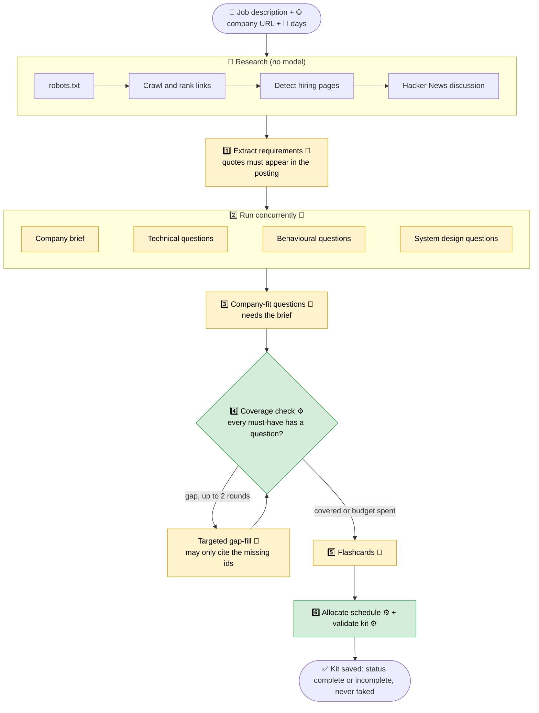
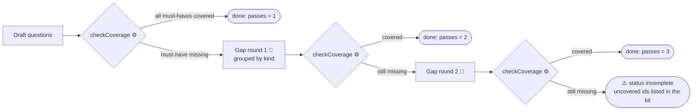
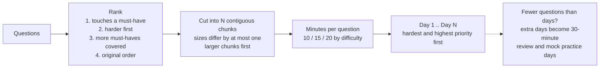
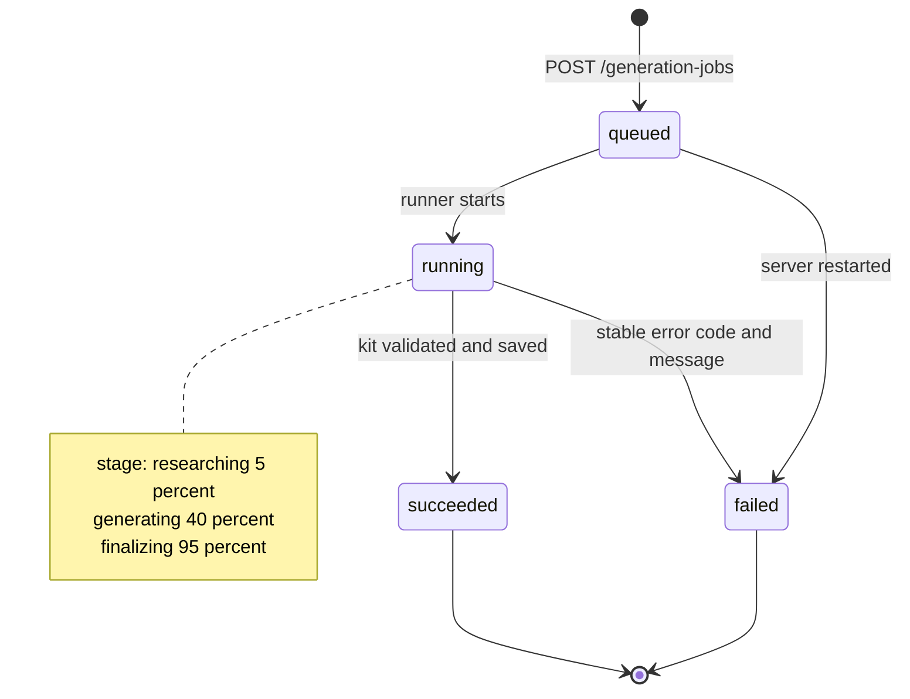
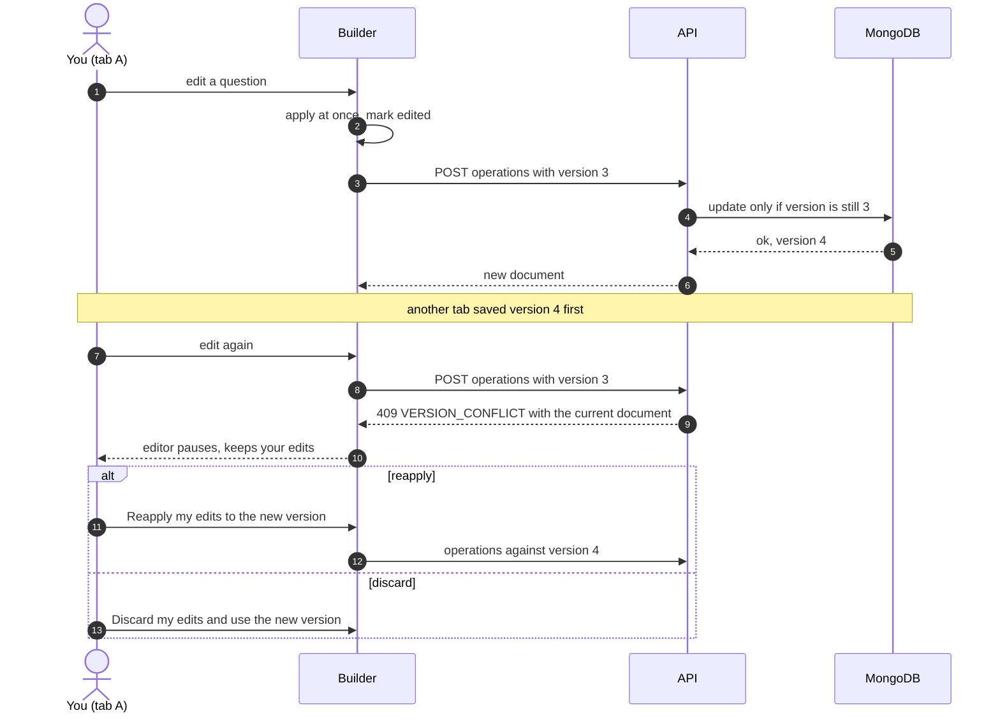
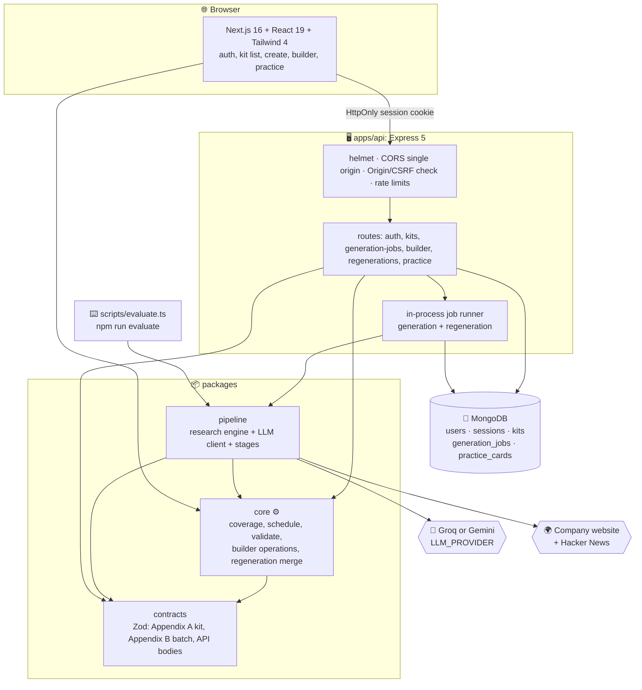
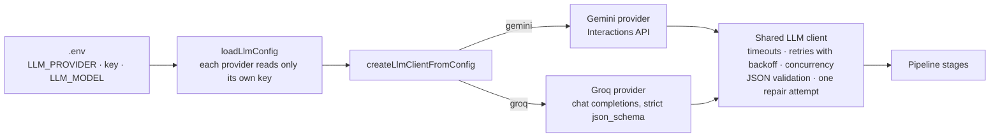
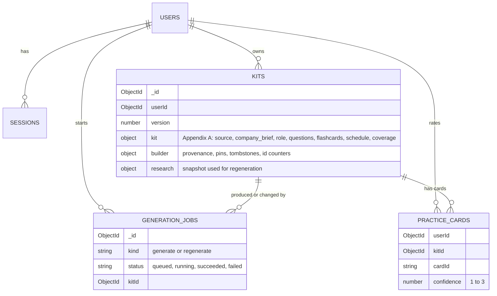
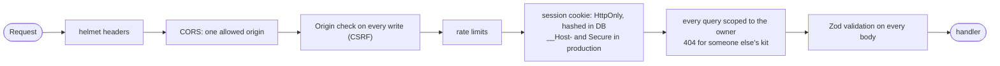

<div align="center">

# 🎯 AI Interview Prep Kit

### Paste a job description. Add a company website. Get a complete, editable interview prep kit.

**Company brief · role breakdown · question bank · flashcards · day-by-day schedule · practice mode**

<br/>


**[⚡ Quick start](#-quick-start-everything-through-make)** ·
**[🧭 How it works](#-how-it-works)** ·
**[🧱 Architecture](#-architecture)** ·
**[🧪 Tests](#-tests-and-quality)** ·
**[🚦 Honest status](#-honest-status)** ·
**[📚 Docs](#-documentation-map)**

</div>

---

## ✨ What you get

| 🧠 Research                                                  | 🤖 Generation                                                  | ✏️ Editing                                                  | 🎓 Practice                                             |
| ------------------------------------------------------------ | -------------------------------------------------------------- | ----------------------------------------------------------- | ------------------------------------------------------- |
| Crawls the company site politely (robots.txt, SSRF-safe)     | Extracts requirements **with quotes from the posting**         | Edit, add, delete, reorder and **pin** anything             | One flashcard at a time, reveal, rate confidence 1 to 3 |
| Finds hiring and interview pages by content, not fixed paths | Writes brief, questions, flashcards with Groq or Gemini        | Optimistic **autosave** with explicit conflict recovery     | Least-confident cards come first                        |
| Pulls public discussion from Hacker News                     | A **deterministic checker** closes coverage gaps (second pass) | **Regenerate** a section and keep what you edited or pinned | Progress saved per user and per kit, resettable         |

<div align="center">

```text
 ┌──────────────────────┐   ┌──────────────────────┐   ┌──────────────────────┐   ┌──────────────────────┐
 │  📝 Job description  │ → │  🔎 Research website │ → │  🤖 Generate + check │ → │  🗓️ Kit, builder,   │
 │  + 🌐 company URL    │   │  (safe, polite)      │   │  (model proposes,    │   │     practice mode    │
 │  + 📅 days (1-60)    │   │                      │   │   code decides)      │   │                      │
 └──────────────────────┘   └──────────────────────┘   └──────────────────────┘   └──────────────────────┘
```

</div>

> 💡 **The one idea behind the design:** _the model proposes, application code decides._ Coverage, the schedule
> and every validation are plain deterministic code. A model reply is accepted only if its quotes really appear
> in the posting or on a fetched page. Gaps are shown honestly instead of being papered over.

---

## 🧭 How it works

### 1. The generation pipeline



🤖 = a model call · ⚙️ = deterministic code. A typical case needs about **7 model calls**; the minimum is 1.
Coverage and the schedule **never** use the model.

### 2. The second pass that closes coverage gaps



The model's claim of success counts for nothing: coverage is recomputed from the questions' ids after every
round, and a round that does not reduce the must-have gaps stops the loop.

### 3. Schedule allocation (pure arithmetic)



### 4. Generation job lifecycle



### 5. Autosave and conflict handling in the builder



---

## 🧱 Architecture



### 🔌 One interface, two model providers



### 🗄️ Data model



### 🛡️ Security layers



Research of untrusted web pages is separate: http(s) only, public addresses only (validated and pinned against
DNS rebinding), every redirect re-validated, hard limits on size, decompression and time, `robots.txt` obeyed.

---

## 🎛️ Key design decisions and trade-offs

| Decision                                              | Why                                                                           | Trade-off                                                          |
| ----------------------------------------------------- | ----------------------------------------------------------------------------- | ------------------------------------------------------------------ |
| **Model proposes, code decides**                      | A model can invent; code can check quotes, ids, coverage and schedule exactly | Items that fail grounding are dropped, so some kits are thinner    |
| **Coverage and schedule are deterministic**           | Reproducible, testable, and never claims coverage it does not have            | The schedule is arithmetic, not "smart" planning                   |
| **Builder state lives beside the kit, not inside it** | Appendix A stays exactly as specified                                         | Two things to keep consistent (written together in one update)     |
| **Optimistic concurrency with a version counter**     | Safe multi-tab editing without locks                                          | Conflicts need an explicit reapply or discard choice               |
| **In-process jobs, single API instance**              | No queue infrastructure to run for the assignment                             | A restart fails running jobs; not horizontally scalable            |
| **Provider-neutral LLM layer**                        | Gemini and Groq share one client with retries, repair and limits              | Groq is limited to models with documented strict structured output |
| **No silent localhost fallback in deployments**       | A forgotten `NEXT_PUBLIC_API_URL` must fail the build, not ship a broken app  | `make build-production` needs an https address                     |

Every limitation is spelled out in [`docs/architecture.md`](docs/architecture.md) and
[`docs/development-decisions.md`](docs/development-decisions.md).

---

## 🧪 Tests and quality

| Check                         | Command                 | Last result (2026-10-20)    |
| ----------------------------- | ----------------------- | --------------------------- |
| 🧪 Unit and component tests   | `make test`             | **1,806 passed** (86 files) |
| 🍃 Integration (real MongoDB) | `make test-integration` | **213 passed** (9 files)    |
| 🔤 Types, lint, formatting    | `make check`            | clean                       |
| 🏗️ Production builds          | `make build`            | pass                        |
| 🌐 Browser / E2E              | none                    | **not implemented**         |

_Results above come from the equivalent `pnpm` scripts. The `make` wrappers are thin and were not run on the
author's machine at the time of writing because GNU Make was not installed there._

Tests use a **fake model and local fixture websites**, so they need no key and no internet. CI
(`.github/workflows/ci.yml`) runs format, lint, typecheck, unit and integration tests against a `mongo:8` service,
both builds and a dependency audit, with **no API key** present.

---

## 🚦 Honest status

<div align="center">

**68 requirements traced** · 🟩🟩🟩🟩🟩🟩🟩🟩🟩🟩🟩🟩🟩🟩🟩🟩🟨🟨🟧⬜ ·
**56 ✅ complete · 6 🟨 partial · 2 🟧 unverified · 4 ⬜ missing** (each square is about 3.4 requirements)

</div>

| Area                                             | Status | Notes                                                                                            |
| ------------------------------------------------ | :----: | ------------------------------------------------------------------------------------------------ |
| Contracts, deterministic core, backend, auth     |   ✅   | Automated tests, real MongoDB                                                                    |
| Research engine and generation pipeline          |   ✅   | Tested with fakes and fixture sites                                                              |
| Web app: create, builder, regeneration, practice |   ✅   | Component tests with a mocked API; used by hand locally                                          |
| Groq provider                                    |   🟨   | Mocked tests, plus **one** live run (valid kit, 45 s, 4 of 10 requests rate-limited and retried) |
| Gemini provider                                  |   🟨   | Measured earlier; the free quota (20 requests a day) allows about two cases a day                |
| Five cases in 15 minutes with a **real** model   |   ⬜   | Shown only with a fake model (26 s of pipeline overhead); not demonstrated live                  |
| Browser and cookie/CORS end-to-end tests         |   ⬜   | No Playwright; HTTP-level and jsdom tests only                                                   |
| Public deployment                                |   ⬜   | **Prepared, not deployed**: see [`docs/deployment.md`](docs/deployment.md)                       |
| Walkthrough video, public repository history     |   ⬜   | Script in [`docs/demo.md`](docs/demo.md); recording is manual                                    |
| Optional creative feature                        |   ⬜   | Not added (practice mode and the builder are core requirements)                                  |

⚠️ **Known quality issue from the live Groq run:** every requirement was marked `nice` although the posting said
"required", and no behavioural questions were produced. One run of one small model; see
[`docs/llm-providers.md`](docs/llm-providers.md).

Every requirement and its evidence: [`docs/requirements-traceability.md`](docs/requirements-traceability.md).

---

## 📚 Documentation map

| Doc                                                                      | What is in it                                                        |
| ------------------------------------------------------------------------ | -------------------------------------------------------------------- |
| [`docs/architecture.md`](docs/architecture.md)                           | Backend, core, research, pipeline, case runner, limits, measurements |
| [`docs/api.md`](docs/api.md)                                             | Every endpoint, error code and job rule                              |
| [`docs/builder.md`](docs/builder.md)                                     | Builder state, operations, conflicts, regeneration                   |
| [`docs/practice.md`](docs/practice.md)                                   | Practice mode rules                                                  |
| [`docs/llm-providers.md`](docs/llm-providers.md)                         | Gemini and Groq: selection, models, structured output                |
| [`docs/local-testing.md`](docs/local-testing.md)                         | Step-by-step manual acceptance guide for Windows                     |
| [`docs/deployment.md`](docs/deployment.md)                               | Environment variables, cookies and CORS, deployment steps            |
| [`docs/demo.md`](docs/demo.md)                                           | Walkthrough video script                                             |
| [`docs/verification.md`](docs/verification.md)                           | What each check proves and what has not been verified                |
| [`docs/requirements-traceability.md`](docs/requirements-traceability.md) | The 68-row requirement matrix                                        |

---

# ⚡ Quick start (everything through `make`)

> The sections below are the full reference. Start here:

```text
make setup     # first time only: installs packages, creates .env from .env.example if it is missing
make dev       # MongoDB (Docker) + API on :4000 + web app on :3000
```

Open **http://localhost:3000** (use `localhost`, not `127.0.0.1`). Run `make` to list every command.

## 🗂️ Layout

```text
apps/web            Next.js + Tailwind frontend: auth, kit list/create, builder, regeneration
apps/api            Express + MongoDB backend
packages/contracts  Zod schemas: Appendix A kit, Appendix B batch files, API request bodies
packages/core       Deterministic logic: coverage, schedule, kit validation, builder operations and
                    regeneration merge (no I/O)
packages/pipeline   Research + LLM stages + orchestration, shared by API and CLI (Phases 4-6)
scripts/evaluate.ts Batch CLI entry point (Phase 6)
Makefile            Every day-to-day command (run `make` for the list)
docs/               api.md, architecture.md, builder.md, practice.md, llm-providers.md, deployment.md, demo.md,
                    local-testing.md, verification.md, requirements-traceability.md, development-decisions.md
```

## Prerequisites

- Node.js >= 20.19 (developed on 24, CI on 22) and pnpm 10 (`npm i -g pnpm@10`)
- Docker Desktop, running (for MongoDB)
- GNU Make. On Windows install it once with `winget install ezwinports.make`, then open a **new** terminal and
  check `make --version`. (`GnuWin32.Make` or `choco install make` also work.)

## Setup in detail

```text
make setup     # first time only: installs packages, creates .env from .env.example if it is missing
               # then open .env and set the model provider and key (see below)
make dev       # starts MongoDB (Docker), waits until it is healthy, then the API and the web app
```

Then open **http://localhost:3000** (use `localhost`, not `127.0.0.1`: the cookie and CORS settings expect it).
The API is on http://localhost:4000. Stop the servers with **Ctrl+C**; MongoDB keeps running until
`make db-stop`.

`make dev` also creates `.env` and installs packages when they are missing, so on a fresh clone it can be the
only command. `make status` shows whether MongoDB, the API and the web app are answering.

**Choose the model in `.env`** (never commit it; it is git-ignored). Details in
[`docs/llm-providers.md`](docs/llm-providers.md):

```text
# Groq
LLM_PROVIDER=groq
GROQ_API_KEY=<your Groq key>
LLM_MODEL=openai/gpt-oss-20b

# Gemini (the default)
LLM_PROVIDER=gemini
LLM_API_KEY=<your Google AI Studio key>
LLM_MODEL=gemini-3.8-flash
```

Without a key everything except generation works, and generation fails with a clear "not configured" message.
Changes to `.env` are read when the API starts, so restart `make dev` after editing it. If port 27018 is already
used by something else, change `MONGO_PORT` in `.env` and use the same port in `MONGODB_URI` and
`TEST_MONGODB_URI`.

Every environment variable is documented in [`.env.example`](.env.example). Secrets (`SESSION_SECRET`,
database credentials, the model keys) are server-side only and must never be committed; the example file
contains placeholders. In production the API refuses to start with a weak `SESSION_SECRET` or with
`ALLOW_PRIVATE_HOSTS=true`.

## Commands

Run `make` to see this list.

| Command                                           | What it does                                                                      |
| ------------------------------------------------- | --------------------------------------------------------------------------------- |
| `make setup`                                      | Install packages and create `.env` if missing                                     |
| `make dev`                                        | Start MongoDB, the API (:4000) and the web app (:3000)                            |
| `make db` / `make db-stop` / `make db-logs`       | Start MongoDB and wait for it / stop it (data kept) / show its recent log         |
| `make status`                                     | Is MongoDB up, and are the API and web app answering?                             |
| `make check`                                      | Format check, lint, typecheck and unit tests (no database)                        |
| `make test` / `make test-integration`             | Unit tests / API tests against a **real MongoDB** (starts it first)               |
| `make verify`                                     | `check`, integration tests and the production build                               |
| `make build`                                      | Next.js production build; the API is type-checked                                 |
| `make build-production API_URL=https://...`       | Deployment build: fails unless the API address is public https                    |
| `make evaluate INPUT=cases.json OUTPUT=kits.json` | The required batch entry point (see "Batch evaluation"); uses your model key      |
| `make down` / `make clean`                        | Remove the containers (data volume kept) / delete `node_modules` and build output |

`make lint`, `make format`, `make format-check` and `make typecheck` run the individual checks. The same things are
available as `pnpm` scripts (`pnpm dev`, `pnpm test`, ...), and `npm run evaluate -- --input cases.json --output kits.json`
is the batch command the assignment names; the Makefile only wraps them.

There is no coverage tooling and there are no browser tests yet: see [`docs/verification.md`](docs/verification.md)
for what each command proves, what has not been verified and how to run the five-case timing check against a real
provider yourself. `make test-e2e` fails on purpose until browser tests exist. Integration tests create and drop a
throwaway database per test file on the same MongoDB; CI runs them against a `mongo:8` service container.

## MongoDB and MongoDB Compass

MongoDB runs from `compose.yaml` (service `mongo`, image `mongo:8`), published only on
`127.0.0.1:27018` (`MONGO_PORT`), with authentication on. The application database is **`trao`**; collections are
`users`, `sessions`, `kits`, `generation_jobs` and `practice_cards`. A kit's `_id` is an **ObjectId** (not a string),
the owner is `userId`, and the Appendix A kit is embedded as the `kit` field beside `builder` and `research`.

To look at the data in Compass:

1. New connection, URI `mongodb://localhost:27018` (no credentials in the URI, and no trailing dot).
2. Advanced Connection Options, Authentication, Username/Password: use `MONGO_ROOT_USER` and
   `MONGO_ROOT_PASSWORD` from your `.env`, and set Authentication Database to `admin`.
3. Open database `trao`, collection `kits`, and filter with `{ "_id": ObjectId("<kit id from the page URL>") }`.

"Command buildInfo requires authentication" means the server is reachable and only the login is missing.

## Troubleshooting

| Symptom                                           | What to check                                                                             |
| ------------------------------------------------- | ----------------------------------------------------------------------------------------- |
| `make: command not found`                         | Install Make (Prerequisites) and open a new terminal                                      |
| `make dev` stops at the database step             | Docker Desktop must be running; `make db-logs`; `.env` must contain the Mongo variables   |
| `EADDRINUSE` on 4000 or 3000                      | An older server is still running; stop it (Ctrl+C in its window) and run `make dev` again |
| Signed out on reload, or CORS errors              | Open `http://localhost:3000`, not `127.0.0.1`; `WEB_ORIGIN` must match                    |
| Generation says it is not configured              | The key for the selected `LLM_PROVIDER` is empty; edit `.env`, restart `make dev`         |
| Still using the old provider after editing `.env` | The API reads `.env` at start; stop and start `make dev`                                  |
| 429 / quota messages                              | Provider limits; see [`docs/llm-providers.md`](docs/llm-providers.md)                     |

More, including a full manual acceptance checklist, is in [`docs/local-testing.md`](docs/local-testing.md).

## Deployment

Prepared but not performed: see [`docs/deployment.md`](docs/deployment.md) for the architecture, every
environment variable (placeholders only), the cookie/CORS settings, the steps and what is unverified. A
deployment must build the web app with `make build-production API_URL=https://...` (`pnpm build:production`); the deployed app refuses to call a missing,
`http` or localhost API address instead of silently using `http://localhost:4000`. CI (`.github/workflows/ci.yml`)
runs format, lint, typecheck, unit and integration tests (real MongoDB service, fake model, no API key), both
builds, and a dependency audit. The demo script is in [`docs/demo.md`](docs/demo.md).

## Using the web app

Start MongoDB and `pnpm dev`, then open http://localhost:3000.

| Page                  | What it does                                                                                                                                                                                                                                                                                                                                                      |
| --------------------- | ----------------------------------------------------------------------------------------------------------------------------------------------------------------------------------------------------------------------------------------------------------------------------------------------------------------------------------------------------------------- |
| `/register`, `/login` | Create an account or sign in. Passwords are validated by the same schemas as the API.                                                                                                                                                                                                                                                                             |
| `/kits`               | Your kits (only yours), with loading, empty, error and retry states.                                                                                                                                                                                                                                                                                              |
| `/kits/new`           | Create one kit (job description, company website, 1-60 days) or **several from a JSON file** in the Appendix B format (at most 10 cases; invalid cases are listed with the reason and are not generated; valid ones run one after another). Progress comes from the server; the address (`?job=` / `?jobs=`) lets you pick a running job up again after a reload. |
| `/kits/[id]`          | The **builder**: company brief, requirements, questions by category, flashcards, the day-by-day schedule, coverage, and section regeneration (see below).                                                                                                                                                                                                         |
| `/kits/[id]/practice` | **Practice mode**: step through the flashcards, reveal each answer, rate your confidence, see what is covered; the next session starts with what you were least sure of. Progress is saved per user and kit.                                                                                                                                                      |

**Authentication.** The API sets an `HttpOnly` session cookie; the web app asks `GET /auth/me` on load
(the cookie cannot be read from JavaScript). Protected pages show only a status while that is checked,
send a signed-out visitor to `/login` (remembering the page, via a same-site path only), and say so
when a session expired. Requests use `credentials: 'include'`, so for local development the web origin
must equal `WEB_ORIGIN` in `.env`. Unsaved builder edits survive an expired session (they are kept in
`sessionStorage` and offered back).

**The contracts.** A kit has exactly the Appendix A fields (`source`, `company_brief`, `role`,
`questions`, `flashcards`, `schedule`, `coverage`); batch files and results are Appendix B. Both are
unchanged by the builder: editing metadata (what was generated, edited, pinned or deleted, and the id
counters) is stored **beside** the kit, never inside it.

## The builder in brief

Full detail, with the rules and the limits, is in [`docs/builder.md`](docs/builder.md).

- **Provenance.** Every question, flashcard and requirement is `generated` or `manual`; editing a
  generated item marks it `edited`; any item, a day or the brief can be **pinned**. Deleting a generated
  item leaves a **tombstone**, so regeneration cannot bring it back. Ids come from monotonic counters and
  are never reused.
- **Coverage and schedule stay honest.** Coverage is recomputed after every change; deleting the last
  question for a must-have shows the gap instead of hiding it. The number of days always equals the
  duration requested. Edits go through one pure set of operations shared by the browser and the server,
  and every result is checked with the same `validateKit`.
- **Autosave.** Edits appear at once and are saved in the background, in order, with the server version
  they were made against; edits made during a save are kept; a failed save keeps everything and waits for
  "Retry saving".
- **Conflicts are explicit.** If the kit changed elsewhere, the editor pauses, keeps your edits, and
  lets you reapply them to the new version (an edit that no longer applies is named) or discard them.
  Nothing is replayed or overwritten without that choice.
- **Regeneration.** The editor can regenerate the **company brief**, **one question category**, or the
  **schedule**. It keeps what you wrote, edited or pinned and what is on a pinned day, never brings back
  anything you deleted, and shows a report of what was kept, replaced, added and skipped and which
  coverage gaps remain. It saves your unsaved edits first, never replaces the editor's document while
  you have unsaved edits, and a kit changed during the run is reported as a conflict rather than
  overwritten.
- **Older kits.** The brief and company-fit questions are regenerated from the research the kit was
  built from. That research is stored only for kits generated after it was introduced (at most 12 pages
  of up to 4,000 characters, interview sentences, and up to 8 discussion snippets; no authors, hashes or
  headers). **For older kits it does not exist and is not reconstructed**, so those two sections cannot be
  regenerated and the editor says why. The schedule and the technical, behavioural and system-design
  questions can still be regenerated for every kit. Flashcards cannot be regenerated.

## Batch evaluation

```bash
npm run evaluate -- --input cases.json --output kits.json
```

`cases.json` is an array of `{ "id", "jd", "company_url", "days" }` (Appendix B). Each case runs the full
research, generation and validation path, one case at a time, and the command writes one Appendix B file
with an entry per case: `status: "ok"` with the kit, or `status: "failed"` with a stable `error.code` and a
curated message. A failing case never stops the run. Setup: `pnpm install`, copy `.env.example` to `.env` and
set the key of the selected provider (`LLM_API_KEY` for Gemini, `GROQ_API_KEY` for Groq; the command loads `.env` when it exists, or reads the process environment).

- **`days`** must be 1-60. A case above 60 is recorded as failed (`INVALID_CASE`), never clamped.
- **Company sites may be local** (for example `http://localhost:8099/acme/`): relative links are followed,
  and loopback is allowed for each case's own host and port only, unless `NODE_ENV=production`.
- **Time:** each case has a 90 s budget (`EVALUATE_CASE_DEADLINE_MS`) and the whole batch 14 minutes
  (`EVALUATE_BATCH_DEADLINE_MS`). Cases that no longer fit are recorded as `BATCH_DEADLINE_EXCEEDED`.
- **Failure codes** (`error.code`): `INVALID_CASE`, `DUPLICATE_ID`, `INVALID_INPUT`, `COMPANY_URL_INVALID`,
  `COMPANY_URL_BLOCKED`, `COMPANY_UNREACHABLE`, `COMPANY_BLOCKED_BY_ROBOTS`, `COMPANY_RESEARCH_FAILED`,
  `LLM_NOT_CONFIGURED`, `LLM_AUTH_FAILED`, `LLM_REQUEST_REJECTED`, `LLM_MODEL_NOT_FOUND`,
  `LLM_QUOTA_EXHAUSTED`, `LLM_RATE_LIMITED`, `LLM_TIMEOUT`, `LLM_UNAVAILABLE`, `LLM_INVALID_OUTPUT`,
  `LLM_CONTENT_BLOCKED`, `DEADLINE_EXCEEDED`, `BATCH_DEADLINE_EXCEEDED`, `KIT_INVALID`,
  `CONFIGURATION_ERROR`, `INTERNAL_ERROR`.
- **Partial results are `ok`:** a site with no hiring page, no public discussion, or a model stage that
  failed part-way still yields a valid kit; the gaps are visible in the kit
  (`coverage.uncovered_requirement_ids`, fewer questions or flashcards) and the command prints each case's
  status and limitations to stderr. Appendix A has no field for limitations, so they are not stored in the
  kit itself.
- **Exit codes:** `0` the output file was written (even if some cases failed), `2` bad arguments, `3` the
  input file is missing, not JSON or not an array, `4` configuration problem (for example no
  `LLM_API_KEY`), `5` the output file could not be written, `1` unexpected error. The output is written
  atomically and only when valid.

## API

Routes, status codes, the error model, session and CSRF design, optimistic concurrency, the job
lifecycle and the index table are documented in [`docs/api.md`](docs/api.md). In short:

- `POST /auth/register | /auth/login | /auth/logout`, `GET /auth/me`
- `GET/POST /kits`, `GET/PUT/DELETE /kits/:id` (PUT takes the `version` you last read; stale writes
  get `409 VERSION_CONFLICT`)
- `GET /kits/:id/builder`, `POST /kits/:id/operations` (builder document and atomic, version-checked edits)
- `POST /kits/:id/regenerations` (`202`, a job for one section)
- `GET /kits/:id/practice`, `PUT /kits/:id/practice/cards/:cardId`, `DELETE /kits/:id/practice` (practice progress)
- `POST /generation-jobs` (`202`, deduplicated while a job for the same input is active),
  `GET /generation-jobs/:id` (generation and regeneration jobs)
- `GET /health` (liveness), `GET /ready` (database)

## Security model (implemented so far)

argon2id password hashing; opaque 256-bit session ids stored server-side only as an HMAC; `HttpOnly`,
`SameSite`, and in production `Secure` + `__Host-` cookies; strict Origin check and CORS allow-list;
owner-scoped queries with a uniform `404` for foreign resources; per-IP rate limiting; Helmet headers;
request-body size limit; one structured error shape with generic 500s and request ids; log redaction.
Limitations are listed in `docs/api.md` (notably: rate limiting is in-memory per process, and
generation jobs run in-process and cannot resume after a restart).

## Research engine

`packages/pipeline` fetches untrusted web pages, so every request goes through one safe fetcher:
http(s) only, public addresses only (validated and pinned, so DNS cannot be rebound), every redirect
re-validated, hard limits on size, decompression, content type and time. The crawler reads
robots.txt first, keeps to the company site, follows links it discovers (no fixed list of paths),
ranks them deterministically and judges pages by their content to find hiring and interview-process
pages. Public discussion comes from the Hacker News Algolia API only. Every limit and every
limitation, including what the manual live check found, is in
[`docs/architecture.md`](docs/architecture.md). Loopback fixture sites are allowed only for an
explicit `host:port` (development, tests, batch) and never in production.

## LLM provider

Two providers sit behind one interface (`LlmProvider`), chosen with `LLM_PROVIDER`:

- **Google Gemini** through Google AI Studio, model `gemini-3.8-flash` (the default). Listed as Stable with a free
  tier in Google's documentation, checked 2026-10-19 (sources in `docs/development-decisions.md`). All the
  timing and quota measurements below are from Gemini.
- **Groq**, key `GROQ_API_KEY`, model `openai/gpt-oss-20b` (or another model with documented strict structured
  output). Tested with mocked HTTP, and run live once (see the status block above). Selection, models, structured
  output and troubleshooting: [`docs/llm-providers.md`](docs/llm-providers.md).

`LLM_MODEL` selects the model and it is **never substituted automatically**.

**Gemini key:** open https://aistudio.google.com/apikey, create a key, and put it in `.env` (a Groq key goes in `GROQ_API_KEY`):

```text
make env                  # creates .env from .env.example if you do not have one
# then edit .env:  LLM_API_KEY=<your key>
```

The key is server-side only: it is read from the environment, sent in a request header, and never logged,
returned in errors, or written to disk by the application. `.env` is git-ignored. If the key is missing the
application fails with a clear configuration error and makes no request. **Quotas are not hard-coded**:
Google does not publish per-model limits, so check yours in AI Studio.

> **Free-tier quota: read this before running the batch.** When this was measured (2026-10-19) the free
> tier of `gemini-3.8-flash` on the development project answered
> `limit: 20 requests per day on Free Tier`. One case needs about 7 requests, so **about two cases per day;
> five do not fit**. The pipeline stops immediately on such an error (it does not retry a day-long wait),
> returns what it has marked `incomplete`, and says when the quota resets. Options: enable billing (roughly
> $0.025 per case by token arithmetic), choose a model with a larger free allowance, or spread cases over days.
> Details and the evidence are in `docs/architecture.md`.

All tuning variables
(`LLM_REQUEST_TIMEOUT_MS`, `LLM_MAX_RETRIES`, `LLM_MAX_CONCURRENCY`, `LLM_MIN_INTERVAL_MS`,
`LLM_THINKING_LEVEL`) are documented in `.env.example`.

> **Privacy.** On the free tier Google may use prompts and responses to improve its products, and human
> reviewers may read them. Do not paste confidential or personal information into job descriptions.

**Measure your own setup** (sends a sample posting to the selected provider; not part of `make test`):

```bash
pnpm llm:smoke                              # sample posting and sample research
pnpm llm:smoke --url https://example.com/   # crawl a real site first, then generate
```

It prints the model calls, retries, tokens and per-stage durations, and writes the result to the
git-ignored `out/` folder. The unit tests use a fake provider and never need a key.

## Deterministic core

Coverage checking, schedule allocation and kit validation are pure functions in `packages/core`,
described in [`docs/architecture.md`](docs/architecture.md).
